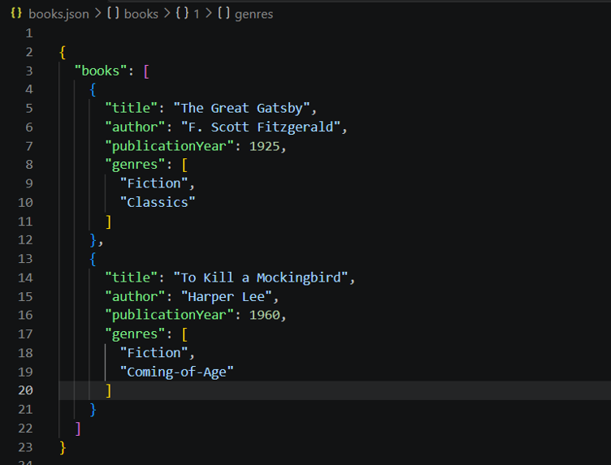
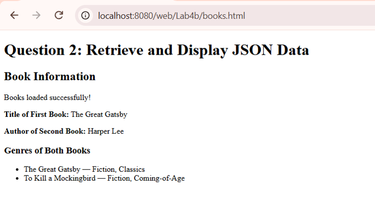
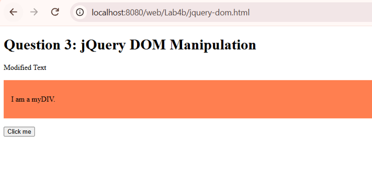
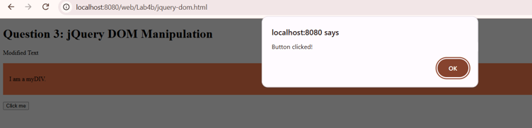

# BIC21203 Lab 4b - JSON and jQuery

**Name:** LIM YONG JIN HENRIK

**Student ID:** CI240095

## Overview

This lab demonstrates JSON data handling,
JavaScript fetch API, and jQuery DOM manipulation.

- **Q1:** Create a JSON file containing book information.
- **Q2:** Retrieve and display JSON data using fetch().
- **Q3:** Manipulate HTML elements and handle events using jQuery.

## How to Run

1. Open XAMPP and start Apache.
2. Place the Lab4b folder inside C:\xampp\htdocs\web\
3. Open the following URLs in a browser:

- Q1: http://localhost/web/Lab4b/books.json
- Q2: http://localhost/web/Lab4b/books.html
- Q3: http://localhost/web/Lab4b/jquery-dom.html

4. Ensure an Internet connection for the jQuery CDN.

## Question 1 - Create and Structure JSON Data

The books.json file contains two book objects with
title, author, publicationYear, and genres.

### Screenshot

## Question 2 - Retrieve and Display JSON Data

The webpage retrieves book information from books.json
using the fetch() API and displays the required data.

### Screenshot

## Question 3 - jQuery DOM Manipulation

This webpage uses jQuery to change text, add a CSS
class, and handle a button click event.

### Screenshots

